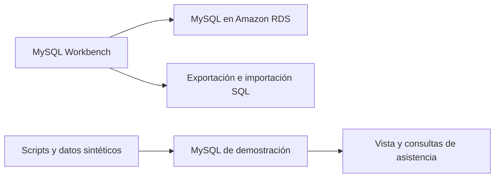

# MySQL en Amazon RDS

En el desarrollo académico trabajé con una base MySQL alojada en Amazon RDS mediante MySQL Workbench. Desde el cliente SQL realicé consultas y ejercicios de exportación e importación lógica. El análisis publicado en este repositorio puede reproducirse en un servidor MySQL independiente, sin necesidad de acceder a la instancia académica.



## Conexión desde MySQL Workbench

Para conectarse a una instancia de RDS se utilizan el endpoint, el puerto y las credenciales autorizadas. Los valores dependen de la instancia y de su configuración de red.

| Campo en Workbench | Valor requerido |
|---|---|
| Connection Method | Standard TCP/IP, si la instancia es accesible por red |
| Hostname | Endpoint de la instancia RDS |
| Port | Puerto configurado en RDS |
| Username | Usuario de MySQL con permisos adecuados |
| SSL | Configuración TLS correspondiente al entorno |

Por seguridad, el repositorio no publica endpoints, contraseñas, archivos de conexión ni certificados privados. En un despliegue real conviene restringir el acceso de red al origen autorizado y verificar la identidad del servidor mediante TLS. Estas son recomendaciones de configuración, no una descripción de controles de infraestructura comprobados en la instancia académica.

## Consultas de diagnóstico

Para identificar la sesión y comprobar el cifrado de una conexión se pueden ejecutar:

```sql
SELECT VERSION(), CURRENT_USER();
SHOW SESSION STATUS LIKE 'Ssl_cipher';
```

La información devuelta depende de la conexión utilizada.

## Reproducir el análisis

El repositorio incluye el esquema, los datos sintéticos, la vista `v_asistencia` y las ocho consultas. Los archivos se ejecutan en el orden indicado en el [README principal](../README.md). El mismo modelo puede utilizarse en una instancia MySQL compatible, siempre que existan permisos suficientes y un esquema de trabajo vacío.
