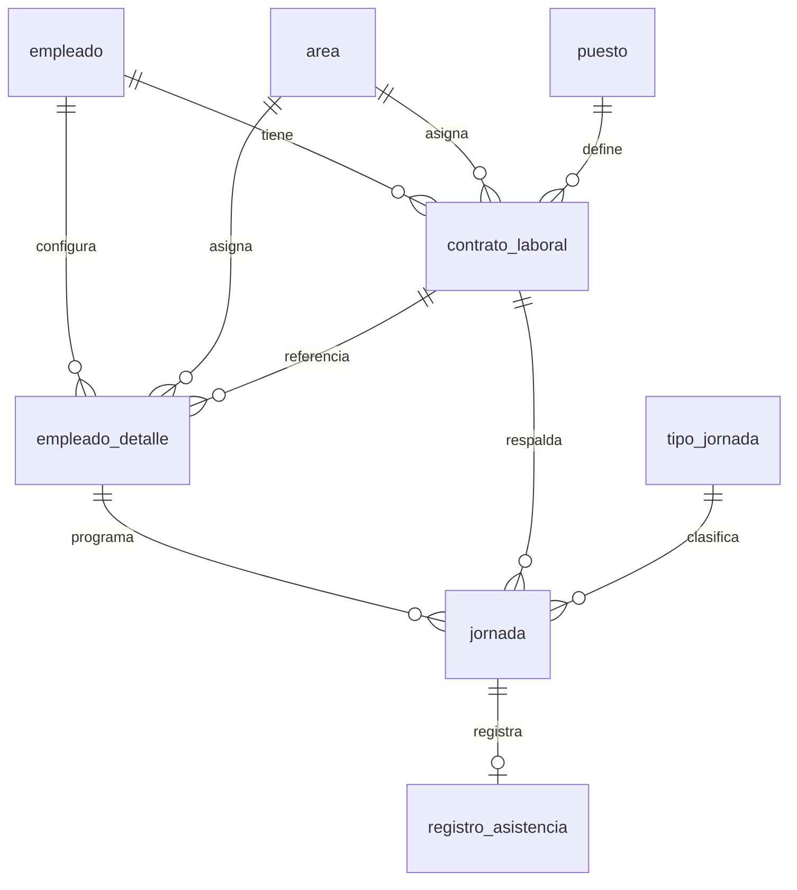

# Modelo de datos y reglas de análisis

El modelo relaciona empleados, contratos laborales, jornadas programadas y registros de asistencia. Los datos sintéticos permiten explorar situaciones habituales de control horario y consistencia contractual.

## Entidades

| Tabla | Unidad representada |
|---|---|
| `empleado` | Empleado ficticio identificado con un código `DEMO` |
| `contrato_laboral` | Contrato con persona, área, puesto y fechas de vigencia |
| `empleado_detalle` | Configuración laboral asociada a una persona y contrato |
| `jornada` | Turno con fecha, inicio, fin y estado activo |
| `registro_asistencia` | Resumen de entrada y salida de una jornada |
| `area`, `puesto`, `tipo_jornada` | Catálogos de clasificación |

## Integridad

Las claves primarias identifican cada registro. Las claves foráneas compuestas vinculan el contrato y el detalle de una jornada con la misma persona. La unicidad de `registro_asistencia.jornada_id` admite como máximo un resumen de asistencia por turno y evita duplicaciones en la vista.

Las restricciones `CHECK` verifican el orden de las fechas contractuales, la relación entre motivo de salida y fecha de término, el estado activo, la fecha del inicio programado y el orden temporal de los horarios y marcas.

Las jornadas fuera de vigencia contractual y las diferencias de área permanecen como casos válidos de almacenamiento para que las consultas puedan detectarlas.

## Fechas y población

Los horarios usan `DATETIME` en hora local. Las fechas completas permiten representar turnos que cruzan medianoche. La vigencia contractual se evalúa en la fecha de inicio de la jornada e incluye ambos extremos del contrato.

Las consultas operativas filtran jornadas activas, con fecha en `[@desde,@hasta)` y fin programado menor o igual a `@corte`. La consulta de configuración de áreas se aplica a los detalles laborales; la consulta de estados presenta todas las jornadas del periodo.

## Marcaje y alertas

Un registro inexistente se distingue de un registro con ambas marcas `NULL`. En ambos casos las marcas faltantes requieren revisión. El estado de marcaje describe la disponibilidad de entrada y salida.

Atraso, salida anticipada, tiempo adicional y contrato fuera de vigencia son indicadores independientes. Los minutos se calculan con `TIMESTAMPDIFF(MINUTE, ...)`, que trunca fracciones: una diferencia positiva de segundos puede activar una alerta y producir cero minutos enteros.

El porcentaje de jornadas con alerta cuenta una sola vez cada jornada, aunque tenga varias condiciones. La diferencia de área se presenta por separado. Con población vacía, los conteos son cero y el porcentaje es `NULL`.

`contrato_vigente_id` identifica el contrato configurado en el detalle laboral. Su vigencia temporal se evalúa por fechas. La comparación de áreas utiliza esa configuración y el contrato referenciado, sin representar movimientos históricos.

## Índices y alcance

El índice `(activo,fecha)` acompaña el filtro operativo. Las claves primarias, foráneas y únicas completan los índices asociados a la integridad. La evaluación de rendimiento requiere un volumen representativo y planes de ejecución con `EXPLAIN`.

El modelo utiliza un resumen de asistencia por turno. Pausas, múltiples marcajes, solapamientos de jornadas, historial de áreas y conversión de zonas horarias requieren reglas y estructuras adicionales.
